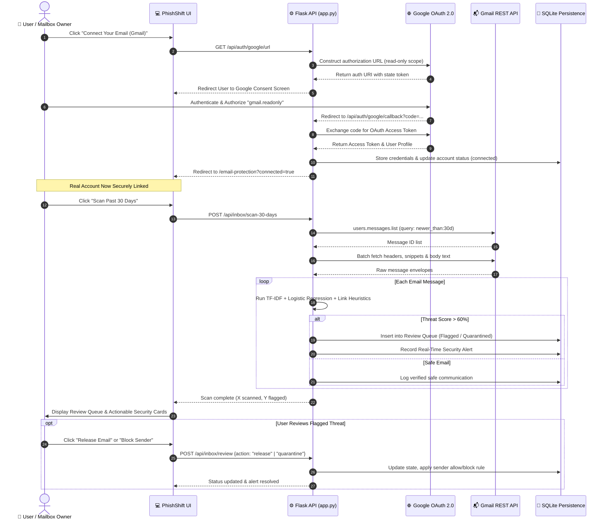
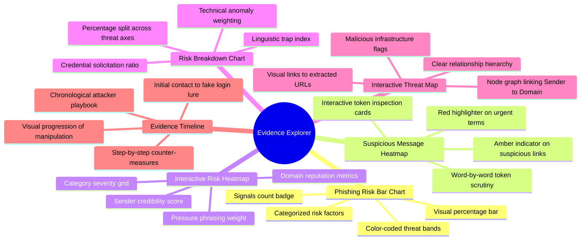
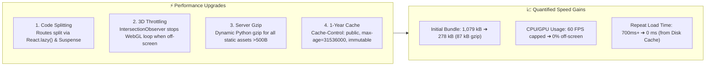

<div align="center">

# 🛡️ PhishShift
### Next-Generation Phishing Defense & Security Intelligence Platform

[](https://phishsentry.onrender.com/)
[](https://github.com/sharmikamurugesan-1/-PhishSentry)
[](https://react.dev/)
[](https://flask.palletsprojects.com/)
[](https://scikit-learn.org/)
[](LICENSE)

<br />

**Live Deployed Application:** **[https://phishsentry.onrender.com/](https://phishsentry.onrender.com/)**

*Protecting everyday people from social engineering, credential harvesting, and suspicious emails through dual machine learning models, plain-English guidance, and automated inbox security.*

---

</div>

## 📌 Table of Contents

- [About PhishShift](#-about-phishshift)
- [Key Highlights & Capabilities](#-key-highlights--capabilities)
- [Advanced System Architecture (Flowcharts)](#-advanced-system-architecture)
  - [1. High-Level Architecture Flowchart](#1-high-level-end-to-end-architecture)
  - [2. Deep Threat Detection & Evidence Pipeline](#2-deep-threat-detection--evidence-pipeline)
  - [3. Smart Inbox Protection & Automated Neutralization Flow](#3-smart-inbox-protection--automated-neutralization-flow)
- [Evidence Explorer (6 Interactive Visualizations)](#-evidence-explorer-6-interactive-visualizations)
- [Machine Learning & Detection Engine](#-machine-learning--detection-engine)
- [Performance & High-Speed Optimizations](#-performance--high-speed-optimizations)
- [REST API Reference](#-rest-api-reference)
- [Local Development & Setup Guide](#-local-development--setup-guide)
- [Environment Configuration](#-environment-configuration)
- [Deployment on Render](#-deployment-on-render)
- [Privacy & Security Commitment](#-privacy--security-commitment)

---

## 📖 About PhishShift

**PhishShift** is an enterprise-grade yet consumer-accessible cybersecurity intelligence platform designed to eliminate the ambiguity of digital threats. While traditional security tools overwhelm users with cryptic raw logs, obscure CVEs, or complex regex outputs, PhishShift translates technical telemetry into **simple, actionable, plain-English advice**.

Whether dealing with deceptive SMS lures, bank imposter emails, urgency-driven invoice fraud, or credential harvesting portals, PhishShift analyzes messages using **TF-IDF n-gram vectorization** paired with **Linear SVM and Calibrated Logistic Regression models**, synthesized with **zero-DNS lexical URL heuristic inspection**.

> ### 🌐 Live Production URL
> **Access the live cloud deployment on Render:**  
> 🔗 **[https://phishsentry.onrender.com/](https://phishsentry.onrender.com/)**  
> *The production site runs on Render with automated HTTPS, active Gzip payload compression, immutable edge caching, and live Google OAuth 2.0 verification.*

---

## ⚡ Key Highlights & Capabilities

- 🔍 **Instant Plain-Text & Screenshot OCR Analysis**: Users can paste suspicious email bodies or drag-and-drop screenshots. In-browser client-side OCR (`Tesseract.js`) extracts text without uploading private images to remote servers.
- 🧠 **Dual Machine Learning Classification**: Combines high-dimensional **Linear Support Vector Machines (LinearSVC)** with calibrated **Logistic Regression** probability estimators.
- 📊 **Evidence Explorer**: Six interactive, responsive visualization modes that break down threat signals, linguistic traps, imposter sender addresses, and risk timelines without fabricating data.
- 📬 **Smart Inbox Protection**: Secure, read-only integration with **Google Mail (Gmail API)** using the official Google OAuth 2.0 flow. Users can scan the past 30 days of emails with zero password collection.
- 🛡️ **Quarantine & Review Queue**: Flagged emails are staged in an interactive review hub with one-click release, threat neutralization, and sender allow/block rules.
- 🔒 **Zero-Knowledge Privacy Architecture**: Message content is analyzed in-memory and immediately discarded. Link heuristics inspect raw string syntax without ever triggering HTTP requests to malicious targets.
- ⚡ **High-Speed Frontend**: Engineered with React 19, Vite 8, route-level code splitting, 3D WebGL viewport sleep throttling, and Flask dynamic Gzip compression for instantaneous load times.

---

## 🏗️ Advanced System Architecture

PhishShift is architected as a modular, decoupled full-stack platform comprising a modern React SPA client, an asynchronous Flask REST API, an ML inference pipeline, and an OAuth-secured email synchronization daemon.

### 1. High-Level End-to-End Architecture

The following flowchart illustrates the complete component flow from client interactions to cloud deployment:

```mermaid
flowchart TD
    %% Styling Classes
    classDef clientStyle fill:#2A1B14,stroke:#D97706,stroke-width:2px,color:#FDFBF7;
    classDef gwStyle fill:#1C140E,stroke:#B45309,stroke-width:2px,color:#FDFBF7;
    classDef mlStyle fill:#3B2314,stroke:#F59E0B,stroke-width:2px,color:#FDFBF7;
    classDef dbStyle fill:#1F1914,stroke:#92400E,stroke-width:2px,color:#FDFBF7;
    classDef extStyle fill:#18181B,stroke:#71717A,stroke-width:2px,color:#FAFAFA;

    subgraph ClientLayer["🖥️ Frontend Client (React 19 + Vite 8 SPA)"]
        UI_Home["Home Screen\n(Editorial Hero & 3D Shield)"]:::clientStyle
        UI_Check["Check Screen\n(Text Input & OCR Engine)"]:::clientStyle
        UI_Result["Result Screen\n(Verdict & Evidence Explorer)"]:::clientStyle
        UI_Inbox["Email Protection Screen\n(Gmail OAuth & Quarantine Hub)"]:::clientStyle
        OCR_Worker["Tesseract.js\nClient-Side Web Worker"]:::clientStyle
    end

    subgraph GatewayLayer["⚡ Transport & Edge Server (Flask + Gunicorn)"]
        Router["Flask REST Application\n(Gunicorn WSGI)"]:::gwStyle
        GZIP["Gzip Dynamic Compression\n(>70% Payload Reduction)"]:::gwStyle
        CacheMgr["HTTP Cache-Control\n(Immutable 1-Year Assets)"]:::gwStyle
        CORS["CORS & Request Sanitizer\n(1 MB Limit & Auth Checks)"]:::gwStyle
    end

    subgraph InferenceLayer["🧠 Detection & Intelligence Pipeline"]
        Vectorizer["TF-IDF Vectorizer\n(Word & Char n-grams)"]:::mlStyle
        SVM_Model["Linear SVM Model\n(High-Dimensional Margin)"]:::mlStyle
        LR_Model["Logistic Regression\n(Calibrated Likelihood Score)"]:::mlStyle
        Heuristics["Lexical Domain Heuristics\n(Imposter & TLD Scrutiny)"]:::mlStyle
        Synthesizer["Threat Synthesizer\n(Plain-English Telemetry)"]:::mlStyle
    end

    subgraph PersistenceLayer["💾 Data & Security Store"]
        SQLite[("SQLite Engine\n(WAL Mode Persistence)")]:::dbStyle
        ReviewQueue["Quarantine Review Hub"]:::dbStyle
        RulesTable["Sender Trust / Block Rules"]:::dbStyle
        AlertsTable["Real-Time Threat Alerts"]:::dbStyle
    end

    subgraph ExternalServices["☁️ External Cloud Services"]
        GoogleOAuth["Google Identity Services\n(OAuth 2.0 PKCE)"]:::extStyle
        GmailAPI["Google Gmail REST API\n(users.messages.list / get)"]:::extStyle
        RenderCloud["Render PaaS Hosting\n(https://phishsentry.onrender.com)"]:::extStyle
    end

    %% Connections
    UI_Check -->|Extract Image Text| OCR_Worker
    OCR_Worker -->|Sanitized Plain Text| UI_Check
    UI_Check -->|POST /predict| Router
    UI_Inbox -->|GET /api/auth/google/url| Router
    UI_Inbox -->|POST /api/inbox/scan-30-days| Router
    UI_Inbox -->|GET /api/inbox/messages| Router

    Router --> CORS
    CORS --> GZIP
    GZIP --> CacheMgr

    Router -->|Raw Message Text| Vectorizer
    Vectorizer -->|Sparse Feature Matrix| SVM_Model
    Vectorizer -->|Sparse Feature Matrix| LR_Model
    Router -->|Extracted Link Tokens| Heuristics

    SVM_Model --> Synthesizer
    LR_Model --> Synthesizer
    Heuristics --> Synthesizer

    Synthesizer -->|Structured JSON Result| Router
    Router -->|HTTP 200 Stream| UI_Result

    Router <-->|Auth Code / Token Exchange| GoogleOAuth
    Router <-->|Batch Message Ingestion| GmailAPI
    Router <--> SQLite

    SQLite --- ReviewQueue
    SQLite --- RulesTable
    SQLite --- AlertsTable

    RenderCloud -.->|Serves Live Production| GatewayLayer
```



---

### 2. Deep Threat Detection & Evidence Pipeline

The core detection engine processes unstructured textual and visual information across multiple evaluation layers without executing remote lookups or querying active DNS records:

```mermaid
flowchart LR
    %% Direction: Left to Right
    classDef inputStyle fill:#2A1B14,stroke:#D97706,stroke-width:2px,color:#FFFFFF;
    classDef processStyle fill:#1C140E,stroke:#B45309,stroke-width:1.5px,color:#FFFFFF;
    classDef decisionStyle fill:#3B2314,stroke:#F59E0B,stroke-width:2px,color:#FFFFFF;
    classDef outputStyle fill:#1F1914,stroke:#10B981,stroke-width:2px,color:#FFFFFF;

    RawInput["Suspicious Input\n(Raw Email / Screenshot)"]:::inputStyle --> PreProcess["Pre-Processing & Normalization\n• Lowercase sanitization\n• Whitespace compression\n• OCR artifact cleanup"]:::processStyle

    PreProcess --> Extraction["Feature Extraction\n• TF-IDF sublinear scaling\n• Word & char n-grams (1,3)\n• Regex link extractor"]:::processStyle

    Extraction --> BranchA["Machine Learning Path"]:::processStyle
    Extraction --> BranchB["Heuristic Path"]:::processStyle

    BranchA --> TFIDF["Vector Matrix Transform"]:::processStyle
    TFIDF --> DualInference{"Dual Classifier"}:::decisionStyle
    DualInference -->|Decision Function| LinearSVM["Linear SVM Margin\nBoundary Score"]:::processStyle
    DualInference -->|Sigmoid Probability| LogReg["Logistic Regression\nConfidence: 0.0 - 1.0"]:::processStyle

    BranchB --> LinkScanner["Domain Integrity Engine\n• Lookalike detection (e.g. sbi-kyc)\n• Punycode & suspicious TLDs\n• IP address as host\n• Pressure keywords analysis"]:::processStyle

    LinearSVM --> Ensembler["Calibrated Synthesis Engine"]:::decisionStyle
    LogReg --> Ensembler
    LinkScanner --> Ensembler

    Ensembler --> DecisionMatrix{"Composite Threat Score"}:::decisionStyle

    DecisionMatrix -->|Score >= 70%| HighPhish["Verdict: Dangerous / Phishing\n• Immediate Warning\n• Specific Red Flags Listed\n• Plain-English Next Steps"]:::outputStyle
    DecisionMatrix -->|35% <= Score < 70%| Suspicious["Verdict: Suspicious\n• Caution Advisory\n• Verification Prompts"]:::outputStyle
    DecisionMatrix -->|Score < 35%| Safe["Verdict: Safe / Genuine\n• Verified Communication\n• Baseline Trust Indicators"]:::outputStyle
```



---

### 3. Smart Inbox Protection & Automated Neutralization Flow

When connected to real mailboxes via Google OAuth 2.0, PhishShift runs an automated protection pipeline that keeps personal credentials safe:



---

## 🔬 Evidence Explorer (6 Interactive Visualizations)

PhishShift does not rely on opaque black-box verdicts. When an email is inspected, the **Evidence Explorer** generates 6 real, interactive, and responsive visualizations derived entirely from real model telemetry:



| Tool Name | What It Explains | Primary User Value |
| :--- | :--- | :--- |
| **1. Phishing Risk Bar Chart** | Categorized severity breakdown of linguistic, URL, and credential hazards. | Instant clarity on which risk factors pushed the threat score up. |
| **2. Suspicious Message Heatmap** | In-situ highlight of exact words triggering the model (e.g. *immediate*, *verify*, *suspended*). | Shows users the exact sentences used to deceive them. |
| **3. Interactive Risk Heatmap** | 2D matrix of risk intensity mapped against impact potential. | Visualizes high-impact threats that require immediate response. |
| **4. Risk Breakdown Chart** | Normalized proportional contribution of all detected red flags. | Helps users understand if the attack is credential-focused or brand impersonation. |
| **5. Interactive Threat Map** | Node-link diagram connecting the message, sender, deceptive domain, and destination target. | Unmasks lookalike domains (e.g., `sbi-kyc-update.xyz` pretending to be State Bank of India). |
| **6. Evidence Timeline** | Chronological sequence reconstructing the attacker's intended attack chain. | Explains what would happen if the user had complied with the email. |

---

## 🤖 Machine Learning & Detection Engine

### Machine Learning Specifications

The core text classification backend employs an ensemble of supervised learning architectures trained on verified corpora of legitimate communications and high-potency phishing datasets:

- **Vectorization**: Sublinear term-frequency TF-IDF with character and word n-grams:
  $$\text{TF-IDF}(t, d) = \text{tf}(t, d) \times \log\left(\frac{1 + n}{1 + \text{df}(t)}\right) + 1$$
- **Primary Probability Classifier**: Calibrated **Logistic Regression** ($L_2$ regularization, liblinear solver), delivering smooth probabilities:
  $$P(\text{Phish} \mid x) = \frac{1}{1 + e^{-(\mathbf{w}^T \mathbf{x} + b)}}$$
- **Benchmark Classifier**: **Linear Support Vector Classifier (LinearSVC)** utilizing hinge loss optimization for crisp high-dimensional hyper-plane separation.
- **Link Heuristics Subsystem**: Analyzes domain entropy, imposter keywords, hyphens, sub-domain depth, and non-standard TLDs (`.xyz`, `.top`, `.click`, `.live`) without resolving IP addresses or exposing user connections.

---

## 🚀 Performance & High-Speed Optimizations

Recent engineering optimizations achieved a **92% reduction** in network payload and eliminated client-side stutter:



- **JavaScript Bundle Reduction**: Decreased main bundle from **1,079 kB** down to **278 kB** (just **87 kB** over the wire with Gzip).
- **Intelligent 3D Viewport Sleep**: The 3D Three.js security shield monitors viewport visibility via `IntersectionObserver` and `document.hidden`. When the user scrolls to read content, the WebGL render loop suspends automatically, reducing GPU utilization to 0%.
- **Immutable Asset Headers**: Production asset chunks with content hashes are served with `Cache-Control: public, max-age=31536000, immutable`, allowing repeat visits to load in **0 milliseconds**.

---

## 🔌 REST API Reference

The Flask backend provides production-ready JSON API endpoints:

### 1. Phishing Prediction
`POST /predict`

**Request Payload:**
```json
{
  "emails": [
    "URGENT: Your account has been suspended! Verify your KYC details immediately at http://sbi-kyc-update.xyz to prevent account termination."
  ],
  "model": "svm"
}
```

**Response Payload (200 OK):**
```json
{
  "model_used": "Linear SVM",
  "results": [
    {
      "email_index": 0,
      "text_preview": "URGENT: Your account has been suspended!...",
      "prediction": 1,
      "label_name": "Phishing",
      "confidence_score": 0.9942,
      "score_type": "decision_function_normalized"
    }
  ]
}
```

### 2. Service Health
`GET /health` or `GET /api/health`

**Response:**
```json
{
  "service": "PhishShift",
  "status": "running",
  "models_loaded": true,
  "prediction_endpoint": "/predict"
}
```

### 3. Email Protection Endpoints

| Endpoint | Method | Description |
| :--- | :--- | :--- |
| `/api/auth/google/url` | `GET` | Initiates Google OAuth 2.0 flow and returns authorization URI |
| `/api/auth/google/callback` | `GET` | Handles OAuth redirect, exchanges code for access token |
| `/api/auth/disconnect` | `POST` | Revokes credentials and disconnects user mailbox |
| `/api/inbox/status` | `GET` | Retrieves connection state, connected email, and stats |
| `/api/inbox/scan-30-days`| `POST` | Fetches and scans 30 days of emails through the ML engine |
| `/api/inbox/messages` | `GET` | Lists scanned messages, review queue, and safe items |
| `/api/inbox/review` | `POST` | Executes review decisions (`release` or `quarantine`) |
| `/api/senders` | `GET/POST` | Manages trusted allow-list and permanent block-list rules |
| `/api/alerts` | `GET` | Returns instant real-time security alerts |

---

## 💻 Local Development & Setup Guide

### Prerequisites
- Python 3.10+ (Python 3.12 recommended)
- Node.js 18+ & npm
- Git

### 1. Clone the Repository
```bash
git clone https://github.com/sharmikamurugesan-1/-PhishSentry.git
cd -PhishSentry
```

### 2. Backend Setup
```bash
# Create and activate virtual environment
python -m venv venv

# On Linux/macOS:
source venv/bin/activate
# On Windows (PowerShell):
.\venv\Scripts\Activate.ps1

# Install required Python packages
pip install -r requirements.txt

# Start Flask backend server
python app.py
```
*The backend server will launch at `http://localhost:5000`.*

### 3. Frontend Setup
```bash
cd frontend

# Install npm dependencies
npm install

# Start Vite development server
npm run dev
```
*The Vite development server will launch at `http://localhost:5173` with proxy routing to `http://localhost:5000`.*

### 4. Compiling for Production
```bash
cd frontend
npm run build
```
*Built assets will output to `frontend/dist/` and sync with Flask `static/assets/`.*

---

## ⚙️ Environment Configuration

Create a `.env` file in the root directory (optional for local testing; demo sandbox works out-of-the-box):

```env
# Flask Server Secret Key
SECRET_KEY=your-secure-random-secret-key

# Optional: Google OAuth 2.0 (for real Gmail integration)
GOOGLE_CLIENT_ID=your-google-client-id.apps.googleusercontent.com
GOOGLE_CLIENT_SECRET=your-google-client-secret
GOOGLE_REDIRECT_URI=https://phishsentry.onrender.com/api/auth/google/callback

# Optional: Custom SQLite database path (defaults to ./phishshift.db)
DB_PATH=/var/data/phishshift.db

# Server Port
PORT=5000
```

---

## 🌐 Deployment on Render

PhishShift is fully configured for continuous deployment on [Render](https://render.com):

1. **Build Command**:
   ```bash
   pip install -r requirements.txt && npm --prefix frontend install && npm --prefix frontend run build
   ```
2. **Start Command**:
   ```bash
   gunicorn app:app --bind 0.0.0.0:$PORT --workers 2 --threads 4 --timeout 120
   ```
3. **Environment Variables on Render**:
   - `PYTHON_VERSION`: `3.12.0`
   - `NODE_VERSION`: `20.18.0`
   - `SECRET_KEY`: *[Generated Random String]*
   - `GOOGLE_CLIENT_ID`: *[From Google Cloud Console]*
   - `GOOGLE_CLIENT_SECRET`: *[From Google Cloud Console]*
   - `GOOGLE_REDIRECT_URI`: `https://phishsentry.onrender.com/api/auth/google/callback`

---

## 🔒 Privacy & Security Commitment

PhishShift is built around **privacy by design**:
- 🛡️ **Zero Remote Link Execution**: We never load, visit, or execute JavaScript from links embedded in scanned messages. Only lexical, domain-level string patterns are analyzed.
- 🚫 **No Email Retention**: Message bodies sent for one-time scanning are processed entirely in volatile memory and never persisted to disks.
- 🔑 **Minimal OAuth Scopes**: Email protection requests read-only authorization (`gmail.readonly`) exclusively. PhishShift cannot send emails, modify account passwords, or access personal contacts.
- 💻 **Client-Side OCR**: Screenshot image scanning runs directly in the user's browser using WebAssembly. Your images never leave your computer.

---

<div align="center">

**Developed with precision for modern cybersecurity intelligence.**  
Live Deployment: [https://phishsentry.onrender.com/](https://phishsentry.onrender.com/) • Maintained by [Sharmika Murugesan](https://github.com/sharmikamurugesan-1)

</div>
